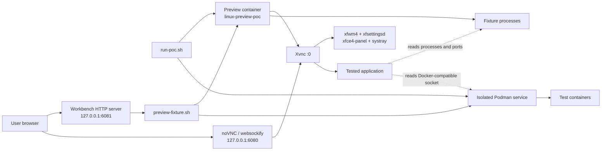

# DistroStage Application Tour

This document describes the current DistroStage proof of concept.

It explains what the application does, how to use it, and how each component
works. It also identifies the current limits. The document describes the
current code. It does not describe a future design.

## 1. Purpose

DistroStage runs a Linux desktop application in an isolated graphical
environment. It displays the native application in a web browser.

DistroStage also creates test workloads. These workloads let a user test how
the application reacts to:

- Multiple development servers.
- Different development server types.
- Running containers.
- Workload start and stop events.
- Native tray menus and application actions.

DistroStage does not copy the tested application UI into HTML. The tested
application runs as a normal Linux process. Xfce renders the application. VNC
transfers the rendered pixels to the browser.

The current reference application is DevLinger. DistroStage does not change
the DevLinger source code.

## 2. Main User Result

The user opens one workbench:

<http://127.0.0.1:6081/>

The workbench contains two main areas:

1. **Native application preview**
   - Shows the noVNC session.
   - Shows the Xfce panel and native tray item.
   - Accepts mouse and keyboard input.
   - Lets the user test the real application UI.

2. **Workload controls**
   - Starts and stops development server fixtures.
   - Shows the state of each fixture.
   - Adds and removes test containers.
   - Shows action output.

The user can change the test environment and operate the tested application
on the same page.

## 3. Quick Start

### 3.1 Requirements

Install these host tools:

- Linux x86-64.
- Podman.
- Python 3.
- A tested application executable that is compatible with Debian 12.

### 3.2 Build the tested application

Example:

```sh
cd /home/andre/Projects/dev-linger
CGO_ENABLED=0 go build -o devlinger .
```

The tested application must be an executable file.

### 3.3 Start DistroStage

```sh
cd /home/andre/Projects/distro-stage
scripts/run-poc.sh /home/andre/Projects/dev-linger/devlinger
```

The command prints four useful values:

```text
Workbench:      http://127.0.0.1:6081/
Native preview: http://127.0.0.1:6080/vnc.html?autoconnect=1
Control shell:  podman exec -it linux-preview-poc bash
Test engine:    CONTAINER_HOST=unix:///tmp/distrostage-<pid>/docker.sock podman ps
```

Open the workbench URL.

### 3.4 Stop DistroStage

Press `Ctrl+C` in the terminal that runs `scripts/run-poc.sh`.

The cleanup operation stops:

- The workbench HTTP server.
- All test containers.
- The isolated Podman service.
- The preview container.
- Xvnc and the graphical processes.
- The tested application.

The cleanup operation also removes the session directory.

## 4. Complete UI Tour

### 4.1 Header

The header shows:

- The product name: `DistroStage`.
- The number of active workloads.

The workload count is:

```text
active fixture servers + running test containers
```

The count does not include the tested application, Xfce, Xvnc, or noVNC.

### 4.2 Native Application Preview

The large preview area contains this page in an `iframe`:

```text
http://127.0.0.1:6080/vnc.html?autoconnect=1&resize=scale
```

The preview shows a 1280 x 800 X display. noVNC scales this display to the
available browser area.

The preview is native rendering. The path is:

```text
tested application
  -> X11
  -> Xvnc display :0
  -> VNC port 5900 inside the container
  -> websockify/noVNC port 6080
  -> browser iframe
```

Use the preview to:

1. Click the native tray icon.
2. Open the application menu.
3. Select application actions.
4. Open application windows and popups.
5. Check that workload changes appear in the application.
6. Check that stop or remove actions update the application.

The reference application scans its environment every 10 seconds. A new
workload can take approximately 10 seconds to appear in its menu.

### 4.3 Dev Servers Table

The `Dev servers` table has four columns:

| Column | Purpose |
| --- | --- |
| Status | Shows `active` or `stopped`. A green marker means active. |
| Type | Shows the fixture type. |
| Port | Shows the default listening port. |
| Actions | Provides `start` and `stop` buttons. |

When a fixture is stopped:

- `start` is enabled.
- `stop` is disabled.

When a fixture is active:

- `start` is disabled.
- `stop` is enabled.

#### Start a development server

1. Find the required server type.
2. Select `start`.
3. Wait for the action result in the `Activity` area.
4. Confirm that the status changes to `active`.
5. Wait for the tested application to scan the environment.
6. Operate the tested application in the native preview.

#### Stop a development server

1. Find the active server.
2. Select `stop`.
3. Confirm that the status changes to `stopped`.
4. Confirm that the tested application removes the workload.

### 4.4 Supported Development Server Types

The image contains these fixture types:

| Type | Default port | Process command |
| --- | ---: | --- |
| `python-http` | 8000 | `python3 -m http.server <port>` |
| `django` | 8001 | `python3 /opt/fixtures/manage.py runserver` |
| `flask` | 5000 | `python3 /bin/flask run` |
| `uvicorn` | 8002 | `python3 /bin/uvicorn <port>` |
| `gunicorn` | 8003 | `python3 /bin/gunicorn <port>` |
| `php` | 8080 | `php -S 0.0.0.0:<port>` |
| `next` | 3000 | `node /opt/fixtures/node_modules/next/dist/bin/next dev` |
| `nuxt` | 3001 | `node /opt/fixtures/node_modules/nuxt/bin/nuxt.mjs dev` |
| `nestjs` | 3002 | `node /opt/fixtures/node_modules/@nestjs/cli/bin/nest.js start` |
| `remix` | 3003 | `node /opt/fixtures/node_modules/@remix-run/dev/dist/cli.js dev` |
| `astro` | 4321 | `node /opt/fixtures/node_modules/astro/astro.js dev` |
| `angular` | 4200 | `node /opt/fixtures/node_modules/@angular/cli/bin/ng.js serve` |
| `vite` | 5173 | `node /opt/fixtures/node_modules/vite/bin/vite.js dev` |
| `storybook` | 6006 | `node /opt/fixtures/node_modules/storybook/dist/bin/dispatcher.js dev` |
| `expo` | 8081 | `node /opt/fixtures/node_modules/expo/bin/cli start` |

These fixtures do not run the real frameworks. They run a small generic HTTP
server. The command path and arguments match the detection catalog of the
reference application.

This design tests process detection. It does not test framework behavior.

### 4.5 Test Containers

The `Test containers` section has:

- A container name field.
- An `Add container` button.
- A table of running test containers.
- A `remove` button for each container.

#### Add a test container

1. Enter a container name.
2. Select `Add container`.
3. Wait for the image pull and container start operation.
4. Confirm that the container appears in the table.
5. Confirm that the active workload count increases.
6. Confirm that the tested application detects the container.

The current implementation always uses:

```text
image: busybox
command: sleep 600
```

The container runs for 600 seconds unless the user removes it first.

#### Remove a test container

1. Find the container in the table.
2. Select `remove`.
3. Confirm that the container leaves the table.
4. Confirm that the tested application removes the container workload.

#### Container name rules

A container name:

- Must start with a letter or a number.
- Can contain letters, numbers, `_`, `.`, and `-`.
- Can contain a maximum of 128 characters.

The workbench rejects other names.

### 4.6 Activity Area

The `Activity` area shows:

- The requested action.
- The fixture helper output.
- A success result.
- A failure result.
- Podman image pull output.

New output appears above old output.

The activity area is not persistent. A page reload clears it.

### 4.7 Responsive Layout

At widths greater than 900 pixels:

- The native preview is on the left.
- The workload controls are on the right.

At widths of 900 pixels or less:

- The native preview is first.
- The controls are below the preview.
- The preview uses 62 percent of the viewport height.

## 5. System Architecture



## 6. Component Map

| File or component | Main responsibility |
| --- | --- |
| `scripts/run-poc.sh` | Creates one preview session and controls its lifecycle. |
| `scripts/preview-ui` | Serves the workbench page and local JSON API. |
| `scripts/preview-fixture.sh` | Starts and stops fixtures and test containers. |
| `poc/Containerfile` | Builds the Debian preview image. |
| `poc/start-xfce.sh` | Starts the graphical environment and tested application. |
| `poc/xfce4-panel.xml` | Defines the minimal Xfce panel and systray. |
| `poc/fixtures/fixture.js` | Implements the generic Node.js HTTP fixture. |
| `poc/fixtures/fixture.py` | Implements the generic Python HTTP fixture. |
| `.containerignore` | Excludes `.git` from the Podman build context. |

## 7. Session Startup Sequence

`scripts/run-poc.sh` is the session owner.

It performs these operations:

1. Verifies that an application argument exists.
2. Verifies that Podman is available.
3. Verifies that Python 3 is available.
4. Resolves the absolute application path.
5. Verifies that the application file exists and is executable.
6. Creates the session path:

   ```text
   /tmp/distrostage-<runner-pid>
   ```

7. Builds the `linux-preview-poc` image.
8. Checks for an old container named `linux-preview-poc`.
   - If it has the DistroStage ownership label, the runner removes it.
   - If it does not have the label, the runner stops with an error.
9. Creates private Podman `root` and `runroot` directories.
10. Starts a rootless Podman API service.
11. Waits for the service socket.
12. Changes the socket mode to `0666`.
13. Starts the preview container.
14. Mounts the tested executable read-only.
15. Mounts the isolated engine socket into the preview container.
16. Starts the workbench HTTP server.
17. Waits for the workbench to answer on port 6081.
18. Prints the workbench and control URLs.
19. Waits for the preview container.

The preview container runs in the host Podman engine. Test containers run in
the separate Podman engine that belongs to the session.

## 8. Preview Container

### 8.1 Base image

The image uses:

```dockerfile
FROM debian:bookworm-slim
```

The image installs only the packages that the current proof of concept needs.

Important packages include:

- `tigervnc-standalone-server`
- `novnc`
- `websockify`
- `xfwm4`
- `xfsettingsd`
- `xfce4-panel`
- `xfconf`
- `dbus-x11`
- `nodejs`
- `php-cli`
- `netsurf-gtk`

The image does not start a complete Xfce desktop session.

It does not use:

- `xfce4-session`
- `xfdesktop`
- Thunar
- A desktop file manager
- A desktop background process

### 8.2 Preview user

The container creates the unprivileged user:

```text
preview
```

Important paths are:

| Path | Purpose |
| --- | --- |
| `/home/preview/.run` | Runtime directory and mounted engine socket. |
| `/home/preview/.run/docker.sock` | Docker-compatible socket for test containers. |
| `/home/preview/.run/bus-address` | D-Bus session address for control shells. |
| `/home/preview/.config` | Xfce configuration. |
| `/opt/linux-preview/app` | Read-only tested application mount. |
| `/opt/fixtures` | Fixture command paths. |

### 8.3 Container environment

The image defines:

```text
DISPLAY=:0
NO_AT_BRIDGE=1
XDG_RUNTIME_DIR=/home/preview/.run
```

The container entrypoint is:

```text
dbus-run-session -- /usr/local/bin/start-xfce
```

This command creates an isolated D-Bus session for the preview.

## 9. Graphical Environment

`poc/start-xfce.sh` starts the graphical components.

### 9.1 Xvnc

Xvnc uses:

| Setting | Value |
| --- | --- |
| Display | `:0` |
| Resolution | `1280x800` |
| Color depth | 24 |
| VNC sharing | Always shared |
| VNC network binding | Container localhost |
| VNC authentication | None |

The host does not publish VNC port 5900 directly.

The script waits for:

```text
/tmp/.X11-unix/X0
```

This socket confirms that the X server is ready.

### 9.2 Xfce components

The script starts:

- `xfwm4 --compositor=off`
- `xfsettingsd`
- `xfce4-panel`

`xfwm4` manages native windows.

`xfsettingsd` applies Xfce settings.

`xfce4-panel` hosts the native system tray.

The compositor is disabled. This reduces the graphical stack and removes a
component that is not necessary for the current tests.

### 9.3 Panel configuration

`poc/xfce4-panel.xml` defines one top panel.

The panel has:

- A length of 100 percent.
- A height of 26 pixels.
- An icon size of 16 pixels.
- A locked position.
- One expanding separator.
- One `systray` plugin.

The expanding separator moves tray items to the end of the panel.

The systray plugin provides:

```text
org.kde.StatusNotifierWatcher
```

The startup script waits for this D-Bus name before it starts noVNC and the
tested application.

### 9.4 noVNC transport

The container starts:

```sh
websockify --web=/usr/share/novnc 6080 localhost:5900
```

The host publishes container port 6080 as:

```text
127.0.0.1:6080
```

Only the local host can use this published address.

### 9.5 Tested application

The startup script runs the application command after the graphical stack and
systray are ready.

If one critical graphical process or the tested application exits,
`wait -n` returns. The container then starts cleanup.

## 10. Fixture System

### 10.1 Detection principle

The reference application detects a development server only when these two
conditions are true:

1. The process command line matches a known server signature.
2. The process owns an active TCP listening port.

DistroStage creates both conditions.

### 10.2 Generic server implementation

The Node.js and Python fixture files both:

- Listen on `0.0.0.0`.
- Read `FIXTURE_PORT`.
- Return `Linux Preview fixture`.
- Have no application logic.

The image copies the same generic server to different command paths. These
paths match the server signatures that the reference application detects.

For example:

```text
/opt/fixtures/node_modules/vite/bin/vite.js
/opt/fixtures/node_modules/next/dist/bin/next
/opt/fixtures/manage.py
/bin/uvicorn
/bin/flask
/bin/gunicorn
```

### 10.3 Fixture start operation

For a `start` command, `scripts/preview-fixture.sh`:

1. Resolves the default port, stop pattern, and command template.
2. Validates that the port contains only digits.
3. Verifies that the preview container is running.
4. Stops an old fixture of the same type.
5. Starts the new process with `podman exec -d`.
6. Sets `FIXTURE_PORT`.
7. Writes process output to:

   ```text
   /tmp/fixture-<type>.log
   ```

8. Reads `/proc/net/tcp` and `/proc/net/tcp6`.
9. Waits a maximum of 10 seconds for the TCP listener.
10. Returns success or prints the fixture log.

### 10.4 Fixture stop operation

For a `stop` command, the helper:

1. Gets the command-line pattern for the fixture type.
2. Reads each `/proc/<pid>/cmdline` file in the preview container.
3. Excludes the stop shell itself.
4. Sends a termination signal to each matching process.

The command-line match is a substring match.

## 11. Isolated Container Engine

The test container engine is a rootless Podman API service.

It uses:

```text
--root <session>/root
--runroot <session>/runroot
--storage-driver vfs
--time=0
unix://<session>/docker.sock
```

The service has private storage. It does not use the normal host Podman
storage. It does not use the host Docker socket.

The runner mounts the session socket at:

```text
/home/preview/.run/docker.sock
```

This location is also:

```text
$XDG_RUNTIME_DIR/docker.sock
```

An application that searches the normal runtime directory can find the
socket.

The socket uses mode `0666` in the current proof of concept. This mode lets
the unprivileged `preview` user use the isolated engine.

## 12. Workbench Server

`scripts/preview-ui` uses only the Python standard library.

It binds to:

```text
127.0.0.1:6081
```

It does not listen on external network interfaces.

### 12.1 Backend functions

| Function | Responsibility |
| --- | --- |
| `run()` | Runs the fixture helper and returns output and success state. |
| `types()` | Parses the fixture catalog from `preview-fixture.sh types`. |
| `containers()` | Gets the test container list from the isolated engine. |
| `listening_ports()` | Reads TCP listeners from the preview container. |
| `state()` | Adds active state to each fixture type and returns the complete UI state. |
| `Handler._send()` | Writes an HTTP response. |
| `Handler.do_GET()` | Serves the page and state endpoint. |
| `Handler.do_POST()` | Validates and runs workload actions. |

### 12.2 HTTP API

#### `GET /`

Returns the workbench HTML page.

#### `GET /api/state`

Returns:

```json
{
  "online": true,
  "activeCount": 0,
  "types": [
    {
      "type": "vite",
      "port": "5173",
      "command": "node /opt/fixtures/node_modules/vite/bin/vite.js dev",
      "active": false
    }
  ],
  "containers": []
}
```

`activeCount` counts active fixture types only. The browser adds the number
of containers when it shows the total workload count.

#### `POST /api/start`

Request:

```json
{"type": "vite"}
```

An optional API client can also send a port:

```json
{"type": "vite", "port": 9000}
```

The current browser UI does not provide a custom port field.

#### `POST /api/stop`

Request:

```json
{"type": "vite"}
```

#### `POST /api/container/start`

Request:

```json
{"name": "probe"}
```

#### `POST /api/container/stop`

Request:

```json
{"name": "probe"}
```

The server rejects:

- A request body larger than 4096 bytes.
- Invalid JSON.
- An unknown fixture type.
- An invalid container name.

### 12.3 Frontend functions

| Function | Responsibility |
| --- | --- |
| `api()` | Sends a JSON request to the local API. |
| `refresh()` | Gets state and updates the tables. |
| `act()` | Runs a fixture or container stop action. |
| `containerStart()` | Starts a test container. |
| `log()` | Adds a line to the activity area. |

The page refreshes state every five seconds.

The page does not rebuild controls when only the Podman uptime text changes.
This behavior prevents a button from moving or disconnecting during a click.

## 13. Ports and Sockets

| Address or path | Owner | Purpose |
| --- | --- | --- |
| `127.0.0.1:6081` | Host Python process | Workbench UI and API. |
| `127.0.0.1:6080` | Preview container port mapping | noVNC web client and WebSocket proxy. |
| `localhost:5900` inside preview | Xvnc | VNC protocol. |
| `/tmp/.X11-unix/X0` inside preview | Xvnc | X11 display socket. |
| `/home/preview/.run/docker.sock` | Isolated Podman service | Docker-compatible API for test containers. |
| `/home/preview/.run/bus-address` | D-Bus session | Session bus address for control shells. |

Fixture ports are inside the preview container. DistroStage does not publish
them to the host.

## 14. Isolation Boundaries

Each preview session has:

- Its own X display.
- Its own D-Bus session.
- Its own runtime directory.
- Its own Xfce configuration.
- Its own test container storage.
- Its own Docker-compatible socket.

The tested application cannot see normal host development server processes.
Those processes are in another PID and network namespace.

The tested application cannot see containers in the normal host Docker or
Podman engine. It sees only the isolated session engine.

The tested executable is mounted read-only.

## 15. Cleanup Sequence

The host runner installs traps for normal exit, `INT`, and `TERM`.

Cleanup uses this order:

1. Stop the workbench server.
2. List all running containers in the isolated engine.
3. Force-remove those test containers.
4. Stop the isolated Podman service.
5. Remove the session directory.
6. Stop the preview container with a two-second timeout.
7. Force-remove the preview container if necessary.

The two-second stop limit is necessary because `dbus-run-session` is PID 1
inside the preview container and can ignore the normal termination signal.

## 16. Expected Warnings

These warnings can appear:

```text
xfsettingsd-WARNING: Failed to get the _NET_NUMBER_OF_DESKTOPS property
```

Cause:

- The preview does not run a complete desktop session or desktop pager.

Effect:

- No effect on the current test functions.

```text
xfwm4-WARNING: Failed to connect to session manager
SESSION_MANAGER environment variable not defined
```

Cause:

- The preview does not run `xfce4-session`.

Effect:

- Xfce does not save and restore desktop sessions.
- Native window management continues to work.

These messages are expected in the minimal environment.

## 17. Error Conditions

### 17.1 Application is not executable

Message:

```text
Application must be an executable file: <path>
```

Action:

1. Build the application.
2. Check the file permission.
3. Run `scripts/run-poc.sh` again.

### 17.2 Preview is not running

Message:

```text
Preview is not running. Start it with scripts/run-poc.sh first.
```

Action:

1. Start the preview.
2. Wait for the workbench URL.
3. Repeat the workload action.

### 17.3 Fixture does not listen

Message:

```text
Warning: <type> is not listening on <port>; log follows.
```

Action:

1. Read the printed fixture log.
2. Check for a port conflict.
3. Stop the old fixture.
4. Start the fixture again.

### 17.4 Container name is invalid

Message:

```text
invalid container name
```

Action:

Use only letters, numbers, `_`, `.`, and `-`. Start the name with a letter or
a number.

### 17.5 Workbench port is in use

Effect:

- `scripts/preview-ui` exits.
- `scripts/run-poc.sh` prints the workbench log.
- The runner starts cleanup.

Action:

Stop the process that uses port 6081. Then start DistroStage again.

## 18. Manual Control

The workbench is the primary control surface. The terminal interface uses the
same helper.

### List fixture types

```sh
scripts/preview-fixture.sh types
```

### Start a fixture on its default port

```sh
scripts/preview-fixture.sh start vite
```

### Start a fixture on a custom port

```sh
scripts/preview-fixture.sh start vite 9000
```

### Stop a fixture

```sh
scripts/preview-fixture.sh stop vite
```

### Add a test container

```sh
scripts/preview-fixture.sh docker start probe
```

### List test containers

```sh
scripts/preview-fixture.sh docker ls
```

### Remove a test container

```sh
scripts/preview-fixture.sh docker stop probe
```

### Open a shell in the preview

```sh
podman exec -it linux-preview-poc bash
```

The login profile reads the session bus address from:

```text
$XDG_RUNTIME_DIR/bus-address
```

## 19. Current Limits

The current proof of concept has these limits:

1. **One session**
   - The preview container name is fixed.
   - Ports 6080 and 6081 are fixed.
   - The fixture helper selects the newest `/tmp/distrostage-*` socket.

2. **One preview profile**
   - The image uses Debian 12 and minimal Xfce.
   - The display size is fixed at 1280 x 800.

3. **Static fixture catalog**
   - The server types are defined in `preview-fixture.sh`.
   - The command paths are built into the image.

4. **Synthetic framework processes**
   - Fixtures do not run real framework projects.
   - Fixtures test detection only.

5. **Fixed test container**
   - The workbench always starts `busybox sleep 600`.
   - The user cannot select another image or command in the UI.

6. **Default-port state display**
   - The workbench marks a fixture active when its default port listens.
   - A fixture started on a custom CLI port can run correctly but show as
     stopped in the workbench.

7. **No saved scenarios**
   - A page reload clears the activity output.
   - A session stop removes all workload state.

8. **No authentication**
   - The workbench has no user authentication.
   - It binds only to `127.0.0.1`.

9. **Permissive test socket**
   - The isolated engine socket uses mode `0666`.
   - The socket exposes only the temporary test engine.

10. **Reserved host container name**
    - The preview uses the fixed name `linux-preview-poc`.
    - The runner refuses to remove an existing container without the
      `io.distrostage.preview=true` ownership label.

11. **Temporary directory assumption**
    - The runner and fixture helper use `${TMPDIR:-/tmp}`.
    - The workbench inherits the runner value.
    - A separate manual shell must use the same `TMPDIR` value to find the
      session socket.
    - Podman 4.9 requires the generated `runroot` path to contain no more
      than 50 characters. Use a short `TMPDIR` value.

12. **Local browser URLs**
    - The workbench iframe uses fixed `127.0.0.1` URLs.
    - Remote browser access is not supported.

## 20. Scale Path

The current implementation proves the interaction model. It is not the final
multi-session system.

A production scale implementation needs:

1. A session identifier for each preview.
2. Dynamic preview and workbench ports.
3. A session registry instead of `/tmp` directory discovery.
4. One API service instead of Python and shell process orchestration.
5. A declarative workload catalog.
6. User-selected container images and commands.
7. Saved and reusable test scenarios.
8. Concurrent session limits.
9. Per-session logs and health data.
10. A stronger socket access model.
11. More graphical environment profiles.
12. Automated native UI action tests.

The current workbench, fixture helper, and isolated engine define the first
vertical slice for that work.

## 21. Verified Behavior

The current implementation has been checked for these operations:

- Workbench starts with the preview session.
- Native application preview loads in the workbench.
- A fixture starts from the workbench.
- Fixture state changes to active.
- A fixture stops from the workbench.
- A test container starts from the workbench.
- A test container appears in the container table.
- A test container stops from the workbench.
- Controls remain stable during periodic refresh.
- The tested application detects five simultaneous fixture types.
- The tested application detects a test container.
- The application remains active after workload changes.
- Session cleanup removes the preview, controller, test engine, socket, and
  test containers.

The workbench received these browser audit results during the current work:

- Accessibility: 100 percent.
- Best practices: 100 percent.
- SEO: 75 percent.

The SEO result is not important for this localhost test tool. The missing item
was a document meta description.

## 22. Glossary

| Term | Meaning |
| --- | --- |
| Workbench | The combined native preview and workload control page on port 6081. |
| Native preview | The noVNC view of the real Linux graphical environment. |
| Preview container | The host Podman container named `linux-preview-poc`. |
| Fixture | A small HTTP server with a process signature that matches a known development tool. |
| Workload | An active fixture or a running test container. |
| Test engine | The isolated rootless Podman service for test containers. |
| Host engine | The normal host Podman engine that runs the preview container. |
| Tested application | The executable mounted at `/opt/linux-preview/app`. |
| Systray | The Xfce panel plugin that displays native status notifier items. |
| Session | One runner process, preview container, workbench, and isolated test engine. |
